

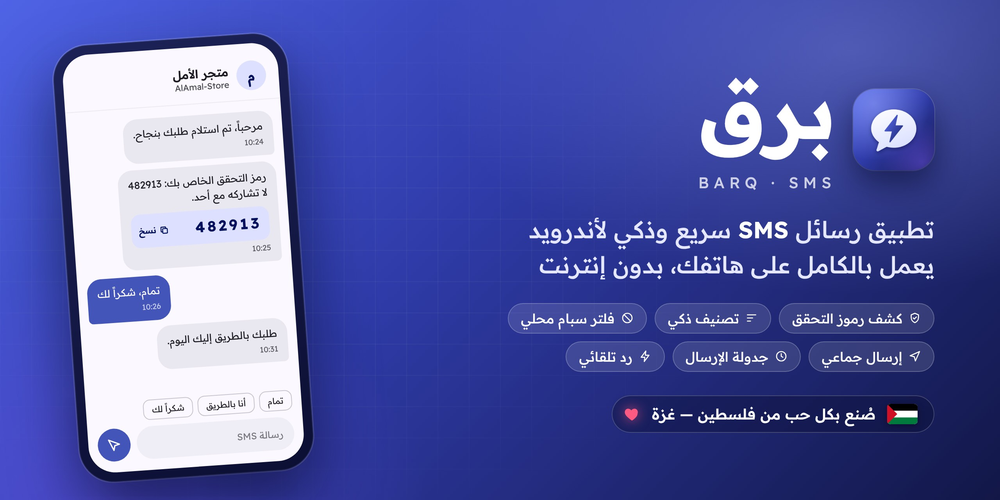

  

# برق

**رسائلك أسرع من البرق.** 
تطبيق رسائل SMS لأندرويد: سريع، ذكي، خاص، ويرسل لألف شخص بضغطة واحدة.

 

  

 

## لماذا برق؟

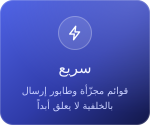
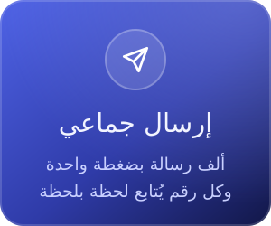
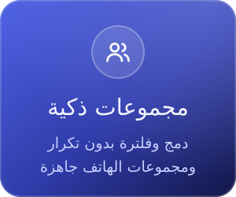
 
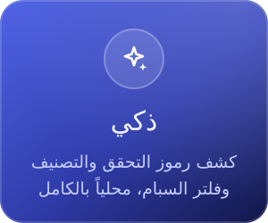
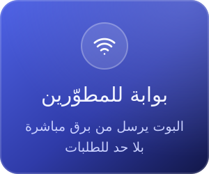
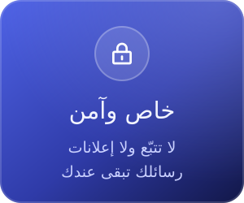

  

## من داخل التطبيق

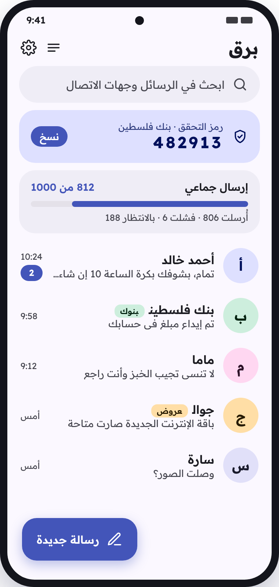
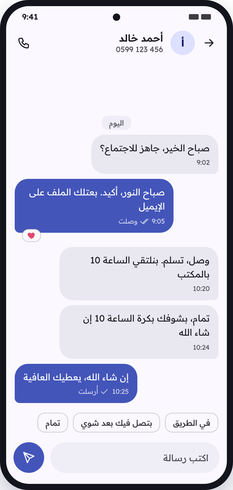
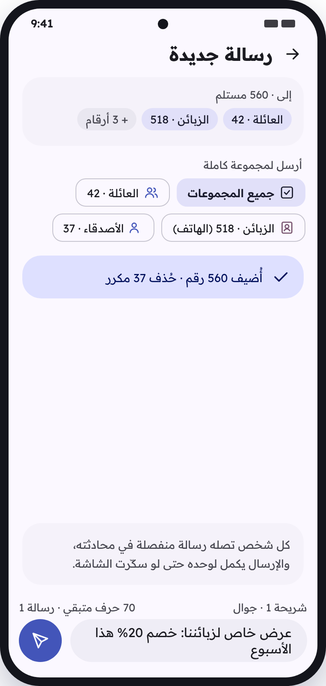

معاينة لواجهة برق: الوارد · المحادثة · رسالة جديدة لعدة مجموعات

 

## كل ما تحتاجه في تطبيق رسائل

- **رموز التحقق** تُكتشف وحدها، وتُنسخ بلمسة من الإشعار أو من أعلى الوارد.
- **تصنيف تلقائي** للبنوك والعروض والرسائل الشخصية، و**فلتر سبام** يعزل الاحتيال.
- **إرسال جماعي** لمئات الأرقام، كل شخص في محادثته، مع متابعة حيّة لكل رسالة وإعادة محاولة تلقائية.
- **المجموعات**: مجموعات برق ومجموعات الهاتف معاً، دمج بضغطة، وكل رقم يُرسل له مرة واحدة فقط.
- **الأرقام الفلسطينية** بأي صيغة (‎+970‎، ‎+972‎، ‎00970‎) تتوحّد تلقائياً إلى ‎05x‎.
- **تفاعلات** على الرسائل، **جدولة** للإرسال، **قوالب** و**رد تلقائي**.
- **الشريحتان**، **تقارير التسليم**، **بحث فوري** يفهم العربية، و**نسخ احتياطي**.
- **فاتح وداكن**، عربي من اليمين لليسار، وإنجليزي تلقائياً حسب لغة الجوال.

## الجديد في 1.6.0

- **غير المقروءة**: زر فوق القائمة يعرض المحادثات غير المقروءة فقط مع عددها، و«قراءة الكل»، ويعمل مع كل التصنيفات. واختصار «غير المقروءة» من أيقونة برق مباشرة.
- **تحديد كغير مقروء** من القائمة أو بالسحب.
- **إعداداتك تنتقل معك** إلى جوال جديد عبر نسخ أندرويد المشفّر (المجموعات والقوالب والإعدادات، بدون الرسائل).
- **نسخ احتياطية مضغوطة** أصغر بكثير، وتنظيف شهري لقاعدة البيانات أثناء الشحن.
- **فحص التحديثات** يعرض رقم النسخة الجديدة وما الجديد فيها.

## الجديد في 1.5.1 و1.5.2

- **إيموجي التفاعلات صارت بستايل Google Noto** اللامع، الأقرب لشكل الآيفون.
- **الإرسال الجماعي الطويل أثبت**: على أندرويد 15 وأحدث يتوقف مؤقتاً بهدوء عند حد الـ 6 ساعات ويسألك تكمّل، بدل ما ينقطع.
- **أخف**: خطوط أصغر، كود أنظف، ونسخ احتياطي تلقائي يحتفظ بآخر 3 نسخ.

## الجديد في 1.5.0

- **قفل التطبيق** ببصمة الإصبع أو الوجه أو رمز الهاتف، وتختار متى يقفل.
- **استيراد من Excel** ورسائل باسم كل شخص عبر ‎{الاسم}‎.
- **مفتاح الشريحة**، **الرسائل المفضّلة**، وتصنيف أذكى يُبقي جهات اتصالك شخصية دائماً.
- **تفاعلات بإيموجي جديدة**، وشاشة «شو الجديد» بعد كل تحديث.
- **بوابة أقوى للمطوّرين**: رقم لكل رسالة، عدة أرقام بطلب واحد، جدولة، واختيار الشريحة.

كل النسخ السابقة وملاحظاتها في **[صفحة الإصدارات](https://github.com/Dev-saged/SMS-Barq/releases)**.

## التثبيت

نزّل أحدث نسخة من [صفحة الإصدارات](https://github.com/Dev-saged/SMS-Barq/releases/latest)، ثبّته، ثم اختر **«اجعل برق تطبيق الرسائل الافتراضي»**. كل نسخة جديدة تُثبَّت فوق السابقة بدون أن تُفقد رسائلك.

 

## المطوّر

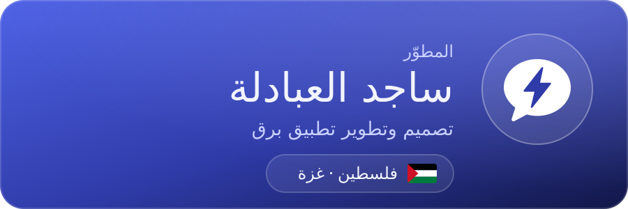

  

 

  

© 2026 ساجد العبادلة (Sajed Al-Abadla) — جميع الحقوق محفوظة · [الترخيص](LICENSE)

