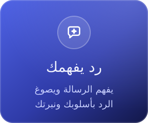
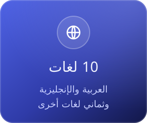
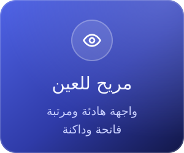
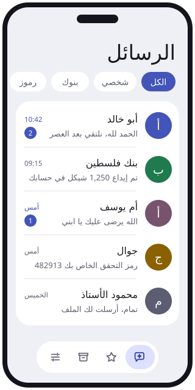
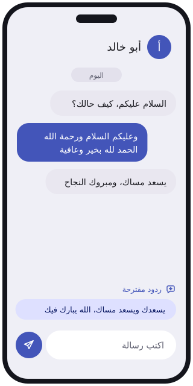
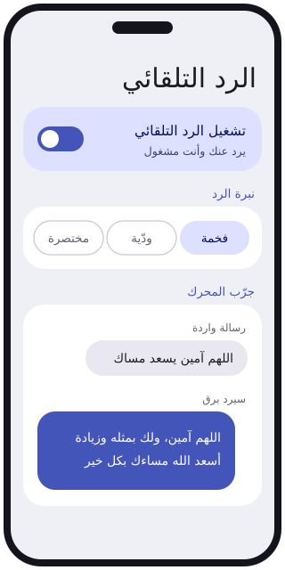

  

  

 

## لماذا برق؟

 

 

  

## من داخل التطبيق

معاينة لواجهة برق: الوارد · المحادثة والردود المقترحة · الرد التلقائي

 

## كل ما تحتاجه في تطبيق رسائل

 &nbsp;**رد تلقائي يفهم الرسالة**: يصوغ الجواب من مضمونها بالنبرة التي تختارها (فخمة، ودّية، مختصرة)، ويتعلّم أسلوبك من ردودك.

 &nbsp;**ردود مقترحة** فوق خانة الكتابة: لمسة واحدة وتكون الرسالة جاهزة.

 &nbsp;**رموز التحقق** تُكتشف وحدها، وتُنسخ بلمسة من الإشعار أو من أعلى الوارد.

 &nbsp;**تصنيف تلقائي** للبنوك والعروض والرسائل الشخصية، وفلتر يعزل رسائل الاحتيال.

 &nbsp;**إرسال جماعي** لمئات الأرقام، كل شخص في محادثته، مع متابعة حيّة وإعادة محاولة تلقائية.

 &nbsp;**المجموعات**: مجموعات برق ومجموعات الهاتف معاً، واستيراد من Excel، ورسالة باسم كل شخص.

 &nbsp;**جدولة** الإرسال، **قوالب** جاهزة، **تفاعلات** على الرسائل، ورسائل **مفضّلة**.

 &nbsp;**بحث فوري** يفهم العربية في الرسائل والإعدادات.

 &nbsp;**سلة محذوفات** للمحادثات والرسائل: استعدها خلال 30 يوماً.

 &nbsp;**قفل التطبيق** بالبصمة أو الوجه أو رمز الهاتف، وحظر للأرقام والكلمات.

 &nbsp;**نسخ احتياطي** تلقائي واستيراد وتصدير، وإعداداتك تنتقل معك إلى جوال جديد.

 &nbsp;**الشريحتان** وتقارير التسليم، والأرقام الفلسطينية تتوحّد بأي صيغة كُتبت.

 &nbsp;**واجهة مريحة**: فاتح وداكن، خط بحجم تختاره، وشريط تنقّل سريع.

 &nbsp;**10 لغات**: العربية، الإنجليزية، الصينية، الهندية، الإسبانية، الفرنسية، البنغالية، البرتغالية، الروسية، الأردية.

 &nbsp;**تحديث من داخل التطبيق**: يخبرك بالنسخة الجديدة ويثبّتها فوق الحالية دون فقد رسائلك.

## الجديد في 2.0

 &nbsp;الرد التلقائي يفهم 32 نوعاً من الرسائل بلهجات متعددة، ويجيب عن كل ما في الرسالة بنبرتك.

 &nbsp;لا يَعِد بشيء باسمك، ولا يرد على «تمام» وأمثالها، ويجيب الأخبار الثقيلة بوقار.

 &nbsp;الرسالة المحذوفة تذهب إلى السلة ويمكن استعادتها.

 &nbsp;بحث داخل الإعدادات، ومحادثات أهدأ للعين.

كل الإصدارات وملاحظاتها في **[صفحة الإصدارات](https://github.com/Dev-saged/SMS-Barq/releases)**.

## التثبيت

1. نزّل أحدث نسخة من **[صفحة الإصدارات](https://github.com/Dev-saged/SMS-Barq/releases/latest)**.
2. ثبّت الملف وافتح برق.
3. اختر **«اجعل برق تطبيق الرسائل الافتراضي»**.

## خصوصيتك

رسائلك تبقى على جوالك. التصنيف والبحث والرد التلقائي تعمل كلها محلياً بلا خوادم، والإنترنت يُستخدم فقط لفحص التحديثات.

 

## المطوّر

  

 

  

© 2026 ساجد العبادلة (Sajed Al-Abadla) — جميع الحقوق محفوظة · [الترخيص](LICENSE)

